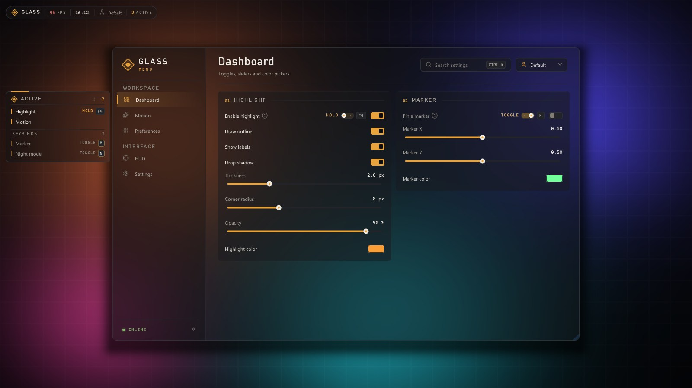
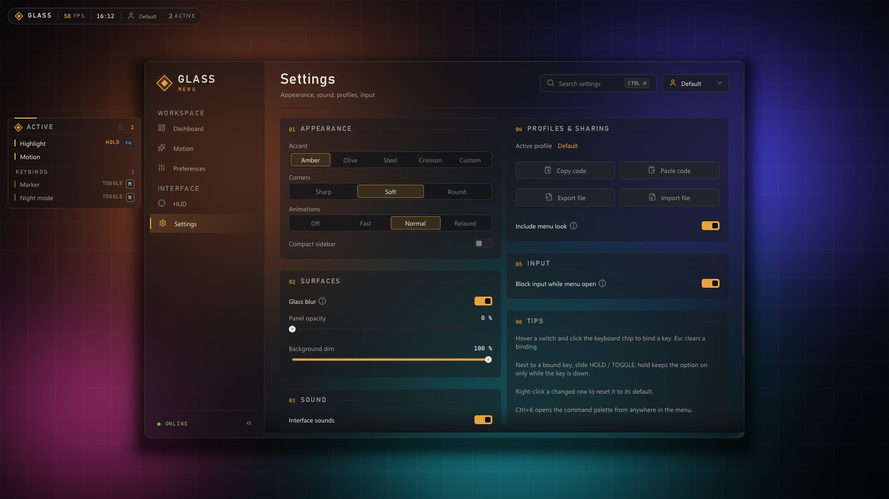
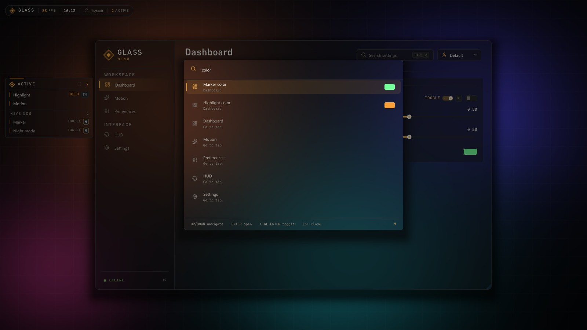
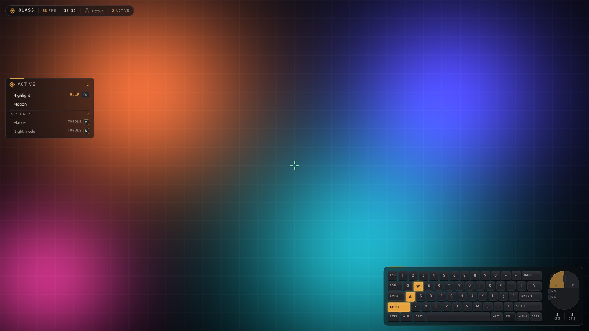
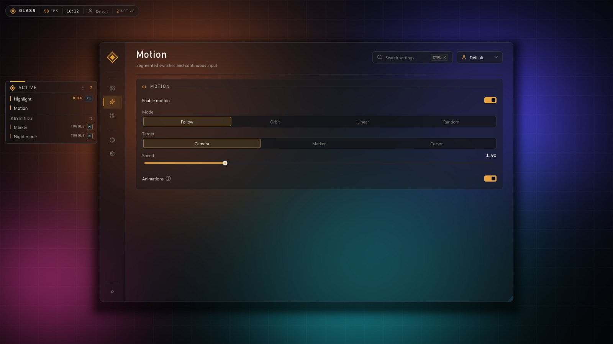
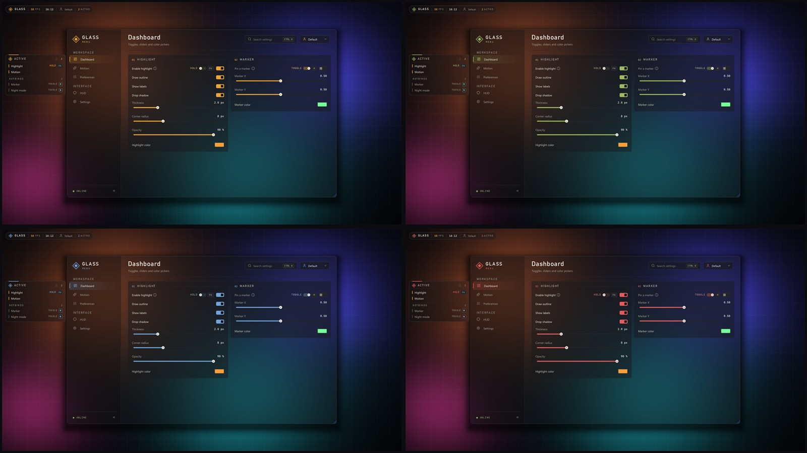

<div align="center">



# Glass Menu

**A polished, glass-blur interface layer for Dear ImGui on DirectX 11.**

Sidebar navigation, animated cards, hotkeys on every toggle, profiles, a command palette and HUD overlays.
Drop it into an existing Dear ImGui app and describe your pages as plain functions.

[](#requirements)
[](#requirements)
[](https://github.com/ocornut/imgui)
[](#use-it-in-your-project)
[](LICENSE)

[**Download demo**](https://github.com/sfr-development/imgui-glass-menu/releases/latest) &nbsp;&middot;&nbsp;
[Quick start](#quick-start) &nbsp;&middot;&nbsp;
[Use it in your project](#use-it-in-your-project) &nbsp;&middot;&nbsp;
[API](#api-reference) &nbsp;&middot;&nbsp;
[FAQ](#faq)

</div>

<br>

## Gallery

<table>
  <tr>
    <td width="50%"></td>
    <td width="50%"></td>
  </tr>
  <tr>
    <td align="center"><sub><b>Built-in settings page</b> &mdash; accents, corners, animation speed, glass, sound, profiles</sub></td>
    <td align="center"><sub><b>Command palette</b> &mdash; <code>Ctrl+K</code> finds every page and every setting</sub></td>
  </tr>
  <tr>
    <td width="50%"></td>
    <td width="50%"></td>
  </tr>
  <tr>
    <td align="center"><sub><b>HUD overlays</b> &mdash; active list with keybinds, info bar, input overlay, crosshair</sub></td>
    <td align="center"><sub><b>Compact sidebar</b> &mdash; collapses to icons with a spring animation</sub></td>
  </tr>
</table>

<p align="center"></p>
<p align="center"><sub>Four built-in accents plus a custom color, switchable at runtime.</sub></p>

<br>

## Features

<table>
<tr>
<td width="50%" valign="top">

**Look and feel**
- Real glass blur behind the menu, rendered with D3D11 shaders
- Soft drop shadows, staggered card entrance, sliding page titles
- Accent presets, custom accent, three corner styles
- Animation speed from instant to relaxed
- Interface sounds with optional hover ticks

**Navigation**
- Grouped sidebar with a gliding selection pill
- Collapsible to an icon rail
- Command palette that searches pages and settings
- Smooth scrolling and edge fades on long pages

</td>
<td width="50%" valign="top">

**Settings that manage themselves**
- Register a value once: it is saved, searchable and bindable
- Hotkey chip on every toggle, hold or toggle mode
- Right-click resets a changed value to its default
- Profiles with autosave, create, switch, delete
- Share codes short enough for a chat message
- Export and import profile files

**HUD**
- Active-features panel with a separate keybind section
- Info bar with FPS, clock, profile and active count
- Keyboard and mouse input overlay
- Crosshair with four styles
- Every HUD element is draggable and snaps to the edges

</td>
</tr>
</table>

<br>

## Quick start

**Try it without building:** grab `glass_menu_demo.zip` from the [latest release](https://github.com/sfr-development/imgui-glass-menu/releases/latest), unzip and run `glass_menu_demo.exe`. Press `Insert` to open or close the menu.

**Build the demo yourself:**

```bash
git clone https://github.com/sfr-development/imgui-glass-menu.git
cd imgui-glass-menu
demo\build.bat
```

`build.bat` finds Visual Studio on its own. The result is `demo\bin\glass_menu_demo.exe`.

**Or with CMake:**

```bash
cmake -S . -B build
cmake --build build --config Release
```

<br>

## Use it in your project

### 1. Add the library

**CMake**

```cmake
add_subdirectory(external/imgui-glass-menu)
target_link_libraries(my_app PRIVATE glass_menu::glass_menu)
```

The target compiles the vendored Dear ImGui as well. If your project already builds its own Dear ImGui, set `GLASS_MENU_BUNDLE_IMGUI=OFF` and make sure the `imgui/` headers are on the include path.

**Without CMake:** add every `.cpp` file in `src/` to your project and put the repository root, `src/` and `imgui/` on the include path. `demo/build.bat` shows the complete compiler command.

### 2. Describe your pages

A page is a function. Cards, toggles and sliders come from the `UI::` namespace.

```cpp
#include "glass_menu.h"

static bool  g_Enabled   = true;
static float g_Intensity = 0.6f;

static void RenderHome() {
    UI::BeginCard("##general", "GENERAL");
    UI::Toggle("Enabled", &g_Enabled);
    UI::SliderPercent("Intensity", &g_Intensity);
    UI::EndCard();
}

static const UI_NavItem kPages[] = {
    { ICON_LC_HOUSE,     "Home",     "Everything at a glance",       "GENERAL",   RenderHome },
    { ICON_LC_CROSSHAIR, "HUD",      "Crosshair, info bar, overlays", "INTERFACE", UI_RenderTab_Hud },
    { ICON_LC_SETTINGS,  "Settings", "Appearance, sound, profiles",   "INTERFACE", UI_RenderTab_Settings },
};
```

### 3. Set it up once

Call this after `ImGui::CreateContext()` and before the Dear ImGui backends are initialized.

```cpp
ApplyTheme();
UIConfig_SetFolder("MyApp");
UI_SetBrand("MY", "APP");
UI_SetStatus("ONLINE");
UI_SetNavigation(kPages, IM_ARRAYSIZE(kPages));
UI_LoadFonts();

ImGui_ImplWin32_Init(hwnd);
ImGui_ImplDX11_Init(device, context);
UIGfx_Init(device, context);

const int home     = UI_TabOf(RenderHome);
const int settings = UI_TabOf(UI_RenderTab_Settings);
const int hud      = UI_TabOf(UI_RenderTab_Hud);
static const Field kFields[] = {
    { "home.enabled",   "Enabled",   home, FieldType::Bool,  &g_Enabled },
    { "home.intensity", "Intensity", home, FieldType::Float, &g_Intensity },
    UI_PROFILE_FIELDS(settings, hud),
};
Registry_Init(kFields, IM_ARRAYSIZE(kFields));
```

### 4. Draw every frame

```cpp
ImGui_ImplDX11_NewFrame();
ImGui_ImplWin32_NewFrame();
ImGui::NewFrame();

UI_RenderOverlay(nullptr, 0);
UI_RenderMenu();

DrawYourScene();
UIGfx_Process(swapChain);

ImGui::Render();
context->OMSetRenderTargets(1, &backBufferRtv, nullptr);
ImGui_ImplDX11_RenderDrawData(ImGui::GetDrawData());
swapChain->Present(1, 0);
```

`UIGfx_Process` copies what is already in the back buffer for the glass blur, so call it after your scene and before `ImGui::Render`.

### 5. Toggle the menu

```cpp
case WM_KEYDOWN:
    if (wParam == VK_INSERT) MenuAnim_Toggle();
    break;
```

Forward messages to `ImGui_ImplWin32_WndProcHandler` as usual.

<br>

## API reference

### Setup and branding

| Function | Purpose |
|---|---|
| `UI_SetNavigation(items, count)` | Pages shown in the sidebar, in order |
| `UI_SetBrand(title, subtitle)` | Text next to the logo, in the info bar and in About |
| `UI_SetStatus(text)` | Label next to the pulsing dot in the sidebar footer |
| `UI_SetLink(icon, label, url)` | Optional button above the footer that opens a URL |
| `UIConfig_SetFolder(name)` | Folder under `%APPDATA%` for `ui.cfg` and profiles |
| `UI_LoadFonts()` | Loads fonts and icons, then the saved look |
| `UI_TabOf(render)` | Index of the page that uses this render function |

### Widgets

| Widget | Notes |
|---|---|
| `UI::BeginCard(id, title)` / `UI::EndCard()` | Numbered card with entrance animation |
| `UI::BeginColumns(id, n)` / `UI::NextColumn()` / `UI::EndColumns()` | Side-by-side cards |
| `UI::Toggle(label, &bool)` | Switch with hotkey chip and hold or toggle mode |
| `UI::Slider(label, &float, min, max, fmt)` | Value slider |
| `UI::SliderInt(label, &int, min, max, fmt)` | Integer slider |
| `UI::SliderPercent(label, &float01)` | 0..1 shown as percent |
| `UI::Segmented(label, &index, items, count)` | Segmented switch |
| `UI::Combo(label, &index, items, count)` | Dropdown |
| `UI::ColorRow(label, float[4])` | Color swatch with picker |
| `UI::Keybind(label, &vk, &mode)` | Key picker |
| `UI::Button(label, icon)` | Full-width secondary button |
| `UI::Hint(text)` | Info icon with a tooltip on the previous label |

### Settings registry

| Function | Purpose |
|---|---|
| `Registry_Init(fields, count)` | Register values; loads the active profile |
| `Hotkey_Set(field, vk)` / `Hotkey_SetMode(field, mode)` | Bind keys from code |
| `Profiles_Load(name)` / `Profiles_Create(name)` | Switch or create profiles |
| `Profiles_ShareCode(includeUi)` / `Profiles_Import(text, hint, includeUi)` | Share codes |

### HUD

| Function | Purpose |
|---|---|
| `UI_RenderOverlay(items, count)` | Active-features panel, info bar, crosshair, input overlay, toasts |
| `UI_RenderTab_Hud()` | Built-in page with all HUD options |
| `g_Hud` | HUD settings, e.g. `g_Hud.crosshair = true` |

`OverlayItem` entries name things that are on. Every registered on/off setting with a hotkey shows up automatically: under **Active** while it is on, under **Keybinds** while it is off.

```cpp
const OverlayItem items[] = {
    { "Highlight", "GENERAL", g_Highlight, &g_Highlight },
};
UI_RenderOverlay(items, IM_ARRAYSIZE(items));
```

<br>

## Requirements

- Windows 10 version 2004 or newer
- A DirectX 11 capable GPU
- Visual Studio 2022 or newer with **Desktop development with C++**
- Dear ImGui 1.91 (included under `imgui/`)

<br>

## Project layout

```
imgui-glass-menu/
├─ src/
│  ├─ glass_menu.h        single include for everything below
│  ├─ ui_layout.*         menu window, sidebar, pages, widgets, settings page
│  ├─ ui_theme.h          colors, accents, radii
│  ├─ ui_gfx.*            glass blur, drop shadows, demo backdrop
│  ├─ ui_registry.*       settings registry, hotkeys, profiles, share codes
│  ├─ ui_overlay.*        active-features panel and HUD dragging
│  ├─ ui_hud.*            crosshair, info bar, input overlay, HUD page
│  ├─ ui_palette.*        command palette
│  ├─ ui_toast.*          notifications
│  ├─ ui_sound.*          interface sounds
│  └─ ui_anim.*, ui_kit.h, ui_config.*, ui_fields.h, IconsLucide.h
├─ imgui/                 Dear ImGui 1.91 with Win32 and DX11 backends
├─ demo/                  demo app and build.bat
├─ docs/                  screenshots
└─ CMakeLists.txt
```

<br>

## FAQ

<details>
<summary><b>Does it work with DirectX 12, Vulkan or OpenGL?</b></summary>
<br>
The widgets are plain Dear ImGui and work with any backend. The glass blur and the drop shadows use D3D11. Without <code>UIGfx_Init</code> the menu falls back to solid surfaces.
</details>

<details>
<summary><b>Where are settings stored?</b></summary>
<br>
In <code>%APPDATA%\&lt;folder&gt;\</code>: <code>ui.cfg</code> for the menu look and window position, and one <code>.cfg</code> file per profile under <code>profiles\</code>.
</details>

<details>
<summary><b>How do I add my own icons?</b></summary>
<br>
All <a href="https://lucide.dev">Lucide</a> icons are built in. Use any <code>ICON_LC_*</code> constant from <code>IconsLucide.h</code>.
</details>

<details>
<summary><b>How do I take screenshots like the ones above?</b></summary>
<br>
Run <code>glass_menu_demo.exe --shot &lt;folder&gt;</code>. The demo walks through every page and writes one image per view.
</details>

<br>

## Credits

- [Dear ImGui](https://github.com/ocornut/imgui) by Omar Cornut, MIT
- [Lucide](https://lucide.dev) icons, ISC

## License

[MIT](LICENSE)
